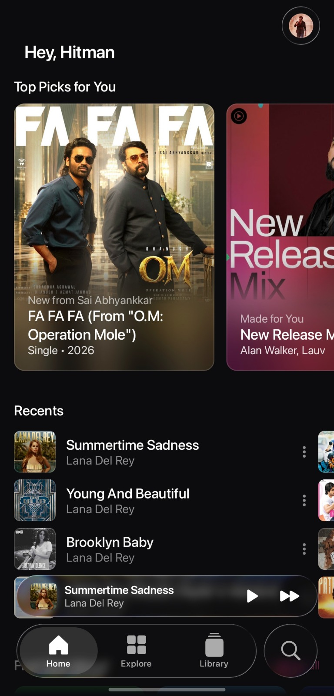
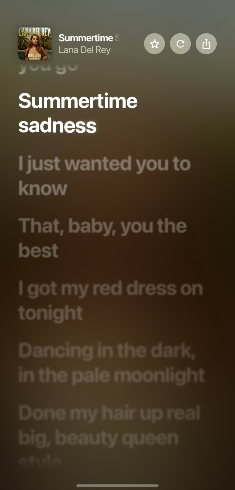
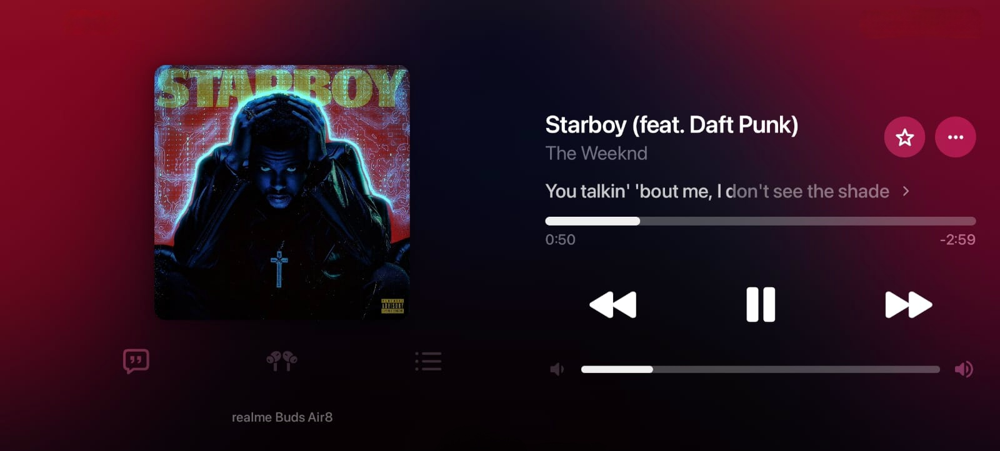

# 🎵 Marshall Android

**Your Music. Your Experience.**

Marshall is an Android music player that brings your music library, playback controls, and immersive listening experience together. This Android project is adapted from the BitChord 1.9.1 source and presents Marshall branding; the separate Windows project is not included here.

[](https://github.com/bhagyarajkota45/Marshall-Android)
[](LICENSE)

## ✨ About Marshall

Marshall combines a modern Android interface with music browsing, playback, and lyric experiences. The project includes phone, Android TV, and Wear OS modules, alongside shared Kotlin code and native audio components.

## 📱 Screenshots

### 🏠 Home



### 🎤 Now Playing / Lyrics



### 🎧 Now Playing — Landscape Mode

Enjoy Marshall's immersive Now Playing experience in landscape orientation, with album artwork, playback controls, synchronized lyrics and audio controls arranged for a wider display.



## 🚀 Features

- 🎶 Browse and search music, and manage queues, playlists, favorites, downloads, and local files.
- ▶️ Background playback, media controls, audio effects, equalizer, crossfade, and playback options.
- 🎤 Word-timed lyrics with active-word highlighting; translation and romanization paths are included.
- 🎞️ Matching Spotify Canvas clips in the player and lyrics views, with static artwork as a fallback.
- 📺 Android phone and TV experiences, plus a Wear OS module.
- 🔗 Existing Google, Spotify, Discord, Last.fm, ListenBrainz, and Listen Together integration flows; some require local or provider-side configuration.

See [FEATURE_STATUS.md](FEATURE_STATUS.md) for verified scope, setup requirements, and known limitations.

## 🎧 Music Experience

The player brings the library, playback controls, and lyrics into one Android experience. Word-timed lyrics can highlight the active word as playback progresses. When a matching Spotify Canvas clip is available, the player and lyrics views can display it; otherwise, the app falls back to static artwork.

## 🛠️ Technology Stack

| Area | Technology |
| --- | --- |
| Android UI and app | Kotlin, Jetpack Compose |
| Shared code | Kotlin Multiplatform |
| Build system | Gradle wrapper |
| Audio components | Native C++ |
| Optional Listen Together server | Go (`backend/`) |

## 📥 Installation

There is no prebuilt APK included in this source repository. To install a production-debug build on a connected Android device:

1. Install JDK 17 and configure the Android SDK, Platform 37, NDK `28.2.13676358`, and CMake `3.22.1`.
2. Copy `local.properties.example` to `local.properties` and set `sdk.dir` to your Android SDK location. This machine-specific file is ignored by Git.
3. From the repository root, build and install:

   ```powershell
   .\gradlew.bat :app:installProdDebug --no-daemon --console=plain
   ```

Enable USB debugging and connect your device first. On macOS or Linux, use `./gradlew` with the same Gradle task.

## 🏗️ Build from Source

The included Gradle wrapper uses Gradle 8.14.4. With the prerequisites and `local.properties` configured as described above, build the production-debug phone app with:

```powershell
.\gradlew.bat :app:assembleProdDebug --no-daemon --console=plain
```

Run the phone and shared-module unit tests with:

```powershell
.\gradlew.bat :app:testProdDebugUnitTest :shared:jvmTest :sharedUi:jvmTest --no-daemon --console=plain
```

On macOS or Linux, use `./gradlew` with the same tasks.

## ⚙️ Local Integration Configuration

Provider credentials and deployment-specific values belong in ignored `local.properties` or environment variables, never in source control. Optional properties include `LASTFM_API_KEY`, `LASTFM_SECRET`, `POTOKEN_GOOGLE_API_KEY`, `POTOKEN_REQUEST_KEY`, `UPDATE_LATEST_RELEASE_URL`, `DISCORD_PROJECT_URL`, `LISTEN_TOGETHER_SERVER`, and `ADDON_AUTH_SERVER`. The PoToken request path needs its local key values; the project builds without them, but that path will not be configured.

The app retains upstream compatibility service hosts where no Marshall-owned endpoint was supplied. Listen Together and addon authentication can be redirected with `LISTEN_TOGETHER_SERVER` and `ADDON_AUTH_SERVER`. The updater and Discord project link remain inactive until `UPDATE_LATEST_RELEASE_URL` and `DISCORD_PROJECT_URL` are configured. Google and Spotify sign-in may require provider-side registration for the Android package ID `com.marshall.music`.

## 🤝 Contributing

Please report bugs and propose changes in the [GitHub issue tracker](https://github.com/bhagyarajkota45/Marshall-Android/issues). Read [CONTRIBUTING.md](CONTRIBUTING.md) before opening a pull request.

## 📜 License and Credits

Marshall retains its upstream GNU General Public License v3.0 (GPLv3), copyright and source notices, and third-party attributions. This Android source is adapted from YT music & Apple Music. See [LICENSE](LICENSE), [UPSTREAM_ATTRIBUTION.md](UPSTREAM_ATTRIBUTION.md), and [ADDITIONAL.md](ADDITIONAL.md) for license and credit details.
